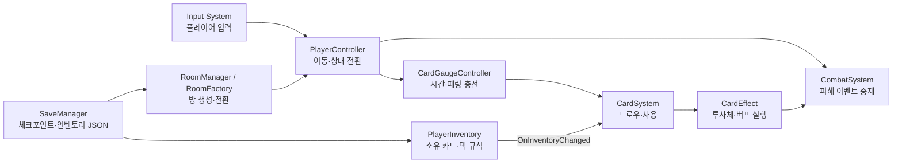
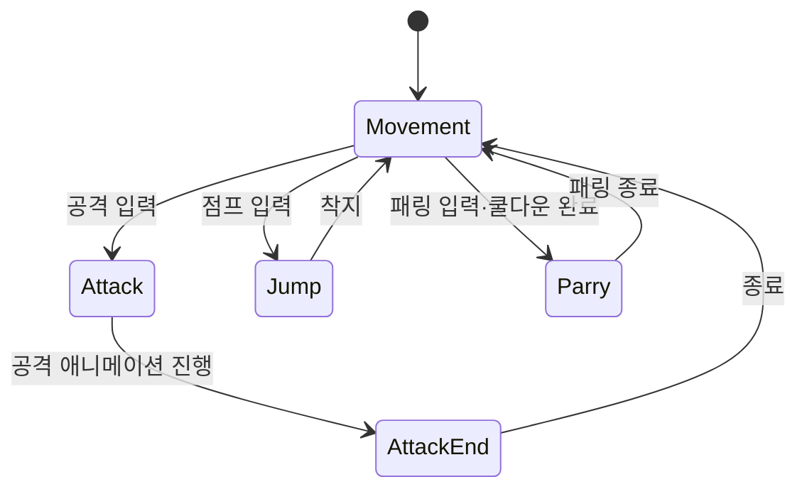
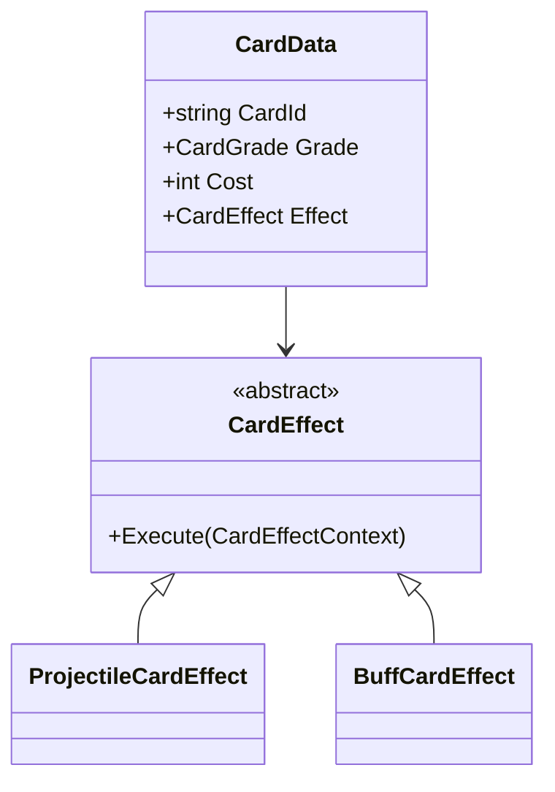
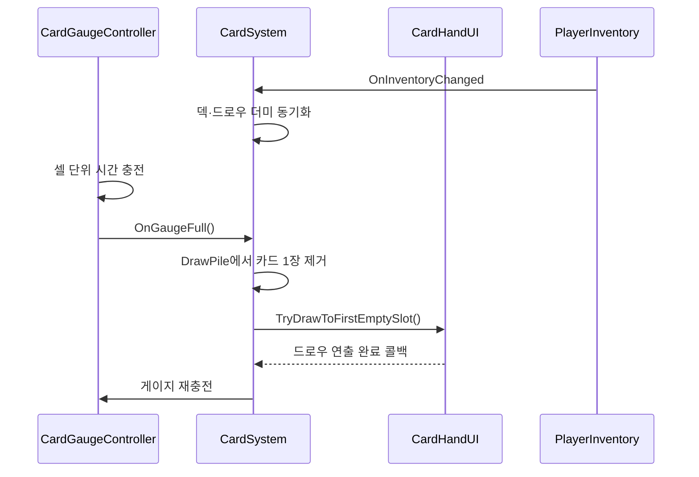
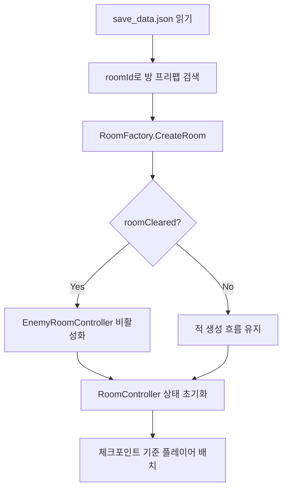

# Arcanist 기술 문서 초안

> 문서 상태: Draft 0.1  
> 기준 소스: 2026-07-21 커밋 `ea9597d7` 이후 작업 트리  
> 작성 목적: 포트폴리오 및 면접 설명용  
> 확인 필요: 개발 기간, 담당 인원/역할, 빌드 플랫폼, 시연 영상·저장소 링크, 성능 측정값

## 1. 프로젝트 개요

### 한 줄 소개

**Arcanist**는 실시간 2D 액션 전투에 카드 드로우와 덱 빌딩을 결합한 Unity 기반 액션 게임입니다. 플레이어는 이동·공격·대시·패링으로 전투하면서, 시간과 패링 보상으로 충전되는 게이지를 통해 카드를 뽑고 상황에 맞는 스킬을 사용합니다.

### 개발 배경과 목표

일반적인 액션 게임의 반복 입력에 카드의 무작위성과 덱 구성 전략을 더해, 같은 전투에서도 서로 다른 판단이 발생하도록 만드는 것을 목표로 했습니다. 이를 위해 다음 문제를 중심으로 시스템을 설계했습니다.

- 플레이어 조작과 애니메이션 상태가 복잡해져도 각 상태의 동작을 추적할 수 있어야 한다.
- 카드 종류가 늘어날 때마다 카드 사용 시스템의 조건문을 계속 수정하지 않아야 한다.
- 인벤토리에서 편집한 덱과 전투 중 드로우·손패·버림패 상태가 일관되게 연결되어야 한다.
- 방 이동, 체크포인트, 사망 후 부활 과정에서 플레이어·방·보상 상태가 어긋나지 않아야 한다.

### 프로젝트 범위

이 문서는 게임 전체 콘텐츠보다 아래 네 가지 기술 영역에 집중합니다.

1. 애니메이터 태그 기반 플레이어 상태 처리
2. ScriptableObject 기반 카드·효과 확장 구조
3. 드로우·손패·버림패와 인벤토리를 연결한 덱 런타임
4. 팩토리 기반 방 생성과 JSON 체크포인트 저장

### 개발 환경

| 분야 | 사용 기술 | 경험 기반 설명 |
|---|---|---|
| 엔진 | Unity 6.3 (`6000.3.15f1`) | 2D 전투, 씬, 프리팹, ScriptableObject 데이터 구성에 사용 |
| 언어 | C# | 상태 객체, 상속·추상화, 이벤트, 코루틴, 제네릭 컬렉션으로 게임 로직 구현 |
| 렌더링 | URP 17.3.0, Shader Graph | 화면 반전·피격 셰이더와 2D 연출 구성 |
| 입력 | Input System 1.19.0 | 이동, 공격, 패링, 카드 단축키 입력 처리 |
| 카메라 | Cinemachine 3.1.7 | 전투 카메라와 임펄스 기반 피드백 구성 |
| 데이터 | ScriptableObject, JSON | 카드 정의는 에셋으로, 체크포인트·인벤토리는 JSON으로 저장 |
| UI·연출 | uGUI, TextMesh Pro, DOTween | 체력·스태미나·카드 UI와 메뉴 및 피격 연출 구현 |
| 레벨 제작 | LDtkUnity 6.12.3, Tilemap | 2D 방 및 스테이지 리소스 제작·연동 |

> **TODO — 포트폴리오 정보:** 개발 기간 `[YYYY.MM ~ YYYY.MM]`, 인원 `[N명]`, 담당 범위 `[기획/프로그래밍/아트 등]`, 대상 플랫폼 `[Windows 등]`을 추가합니다.

## 2. 시스템 구조

### 전체 런타임 흐름



### 핵심 구성요소

| 구성요소 | 역할 |
|---|---|
| `PlayerController` | 입력, 이동, 스태미나, 대시·패링 및 애니메이터 상태 객체의 생명주기를 조율 |
| `PlayerAnimStateBase`와 상태 클래스 | 이동·공격·점프·패링별 `Enter/UpdateState/Exit` 동작을 분리 |
| `CombatSystem` | 공격자와 피격자 사이의 피해·회복 이벤트를 전달하고 관찰자에게 결과를 통지 |
| `CardData` | 이름·등급·비용·아이콘·효과 등 카드의 정적 데이터를 보관 |
| `CardEffect` | 카드 효과의 공통 실행 계약을 제공하는 추상 ScriptableObject |
| `CardSystem` | 덱, 드로우 더미, 손패, 버림패와 카드 사용 흐름을 관리 |
| `PlayerInventory` | 소유 카드와 편집 덱을 보관하고 카드 수·마나 비용 규칙을 검증 |
| `RoomManager` | 현재 방의 생성·제거, 플레이어 배치, 페이드 전환과 다음 씬 이동을 담당 |
| `RoomFactory` | 방 인스턴스 생성과 체크포인트 상태 적용을 분리 |
| `SaveManager` | `persistentDataPath`의 JSON 파일로 체크포인트와 인벤토리를 영속화 |

### 설계 경계

- **정적 설정과 런타임 상태를 분리했습니다.** `CardData`와 `CardEffect`는 에셋, 손패·드로우 더미·버림패는 `CardSystem`의 런타임 컬렉션입니다.
- **인벤토리를 덱 상태의 원본으로 두었습니다.** `PlayerInventory.OnInventoryChanged`가 발생하면 `CardSystem`이 전투 덱을 동기화합니다.
- **전투 전달을 중앙화했습니다.** `HitBox`가 직접 여러 대상 타입을 분기하지 않고 `CombatSystem`과 `CombatEntity` 계약을 통해 피해를 전달합니다.
- **방 생성 책임을 교체 가능하게 분리했습니다.** `RoomManager`는 생성 절차를 호출하고, 실제 인스턴스화는 `PrefabRoomFactory`가 담당합니다.

## 3. 핵심 기능

### 3.1 애니메이터 태그와 상태 객체를 연결한 플레이어 제어

#### 문제

이동, 공격, 공격 종료, 점프, 패링은 입력 가능 여부와 이동 처리 방식이 서로 다릅니다. 모든 분기를 하나의 `Update()`에 넣으면 애니메이션 전환이 늘어날수록 조건문과 상태 플래그가 얽히게 됩니다.

#### 해결

`PlayerController`는 현재 Animator State의 `tagHash`를 조회하고, 태그에 대응하는 `PlayerAnimStateBase` 객체로 실행을 위임합니다. 상태가 바뀔 때만 이전 상태의 `Exit()`와 새 상태의 `Enter()`를 호출합니다.

```csharp
AnimatorStateInfo stateInfo = Animator.GetCurrentAnimatorStateInfo(0);
PlayerAnimStateBase nextState =
    StateDic.GetValueOrDefault(stateInfo.tagHash, defaultState);

if (currentState != nextState)
{
    currentState?.Exit();
    currentState = nextState;
    nextState.Enter();
}

currentState.UpdateState(stateInfo);
```



#### 효과

새 애니메이션 상태를 추가할 때 해당 상태 클래스와 태그 매핑을 추가하는 방식으로 동작을 확장할 수 있습니다. 입력 조율은 `PlayerController`에 남아 있어 완전한 독립 상태 머신은 아니지만, 애니메이션별 프레임 동작은 개별 객체에서 추적할 수 있습니다.

### 3.2 ScriptableObject 다형성을 이용한 카드 효과 확장

#### 문제

투사체, 회복, 피해 증감, 카드 게이지 가속, 1회 부활처럼 카드 효과가 다양해질수록 `CardSystem` 내부의 카드 ID별 `switch` 문은 변경 범위를 키웁니다.

#### 해결

`CardData`가 추상 `CardEffect`를 참조하고, 각 효과 에셋이 `Execute(CardEffectContext)`를 구현하도록 구성했습니다. 실행 시점의 플레이어, 시전 위치, 방향, 타깃은 불변 컨텍스트로 묶어 전달합니다.

```csharp
public abstract class CardEffect : ScriptableObject
{
    public virtual bool RequiresTarget => false;
    public abstract void Execute(CardEffectContext context);
}
```



`ProjectileCardEffect`는 생성 위치와 조준 방식을 조합해 전방형·타깃형 효과를 재사용하며, `BuffCardEffect`는 modifier 목록으로 피해 증가, 받는 피해 감소, 회복, 게이지 가속, 1회 부활을 표현합니다.

#### 효과

카드 사용 흐름을 수정하지 않고 새 `CardEffect` 에셋 또는 구현 클래스를 추가할 수 있습니다. 기획 값도 Inspector에서 조정할 수 있어 코드와 콘텐츠 데이터의 변경 경계를 분리했습니다.

### 3.3 게이지 기반 드로우와 덱 런타임 동기화

#### 동작 흐름



전투 덱은 다음 네 컬렉션으로 상태를 명확히 나눕니다.

- `playerDeck`: 인벤토리에서 확정된 전투 덱
- `drawPile`: 앞으로 뽑을 카드
- `hand`: 현재 사용 가능한 카드
- `discardPile`: 사용 후 대기 중인 카드

드로우 더미가 비면 버림패를 다시 섞어 순환시키며, 덱 편집이 발생하면 기존 손패를 보존하면서 드로우 더미와 버림패에서 더 이상 덱에 없는 카드만 제거합니다. 새로 추가된 카드는 중복 여부를 확인한 뒤 드로우 더미에 넣습니다.

`PlayerInventory`는 최소 6장, 총 비용 8~14, 최대 20장이라는 덱 규칙을 데이터로 관리합니다. 패링 성공 시 게이지 셀을 즉시 보상하는 흐름도 있어 액션 숙련도가 카드 사용 빈도로 이어집니다.

### 3.4 방 전환과 체크포인트 복원

#### 문제

체크포인트 부활은 단순히 플레이어 위치만 옮기는 기능이 아닙니다. 현재 방 ID, 방 클리어 여부, 보상 획득 여부, 적 재생성 여부와 체력을 함께 복원해야 합니다.

#### 해결

`SaveData`를 체크포인트와 인벤토리 데이터로 분리하고 JSON으로 저장했습니다. `RoomManager`는 저장된 `roomId`를 프리팹의 `RoomController.RoomId`와 비교해 방을 찾고, `RoomFactory`에 `startCleared`와 `rewardObtained`를 전달합니다.



페이드 연출은 `WaitForSecondsRealtime`을 사용해 일시 정지 여부와 무관하게 진행하고, 방이 더 없으면 다음 Build Settings 씬으로 이동하도록 구성했습니다.

## 4. 고민과 선택

### 선택 1 — 카드별 상속 객체 vs 하나의 거대한 효과 분기문

| 기준 | 거대한 `switch` 문 | `CardEffect` 다형성 (선택) |
|---|---|---|
| 초기 구현 | 빠름 | 타입과 에셋 구성이 필요 |
| 신규 효과 추가 | 중앙 코드를 계속 수정 | 새 효과 구현 또는 에셋 조합 |
| Inspector 튜닝 | 분기 코드와 결합 | 효과별 직렬화 필드로 조정 |
| 테스트 범위 | 모든 카드 분기 회귀 확인 | 해당 효과 중심으로 확인 가능 |
| 단점 | 클래스 수는 적지만 결합도가 증가 | 효과 타입과 에셋 수가 늘어날 수 있음 |

콘텐츠 확장을 우선해 `CardEffect` 다형성을 선택했습니다. 단, `BuffCardEffect` 내부에는 modifier 타입별 분기가 남아 있습니다. 향후 modifier 자체도 전략 객체로 분리하면 새 버프 추가 시 해당 클래스의 수정까지 줄일 수 있습니다.

### 선택 2 — 방을 씬으로 분리 vs 프리팹으로 교체

현재 일반 방은 프리팹으로 생성·제거하고, 스테이지 경계에서만 씬을 전환합니다. 방마다 씬을 로드하는 방식보다 같은 전투 컨텍스트와 플레이어 객체를 유지하기 쉽고 전환 흐름이 단순합니다. 반면 방 규모가 커지면 프리팹 의존성과 순간 생성 비용이 커질 수 있으므로, 콘텐츠 규모가 확대되면 Addressables 또는 additive scene 전환을 검토할 수 있습니다.

### 선택 3 — ScriptableObject 카드 정의 vs 저장 파일에 전체 카드 직렬화

카드의 정적 정의는 ScriptableObject로 유지하고, 저장 데이터에는 카드 ID 목록만 기록합니다. 저장 용량과 중복을 줄이고 밸런스 값을 에셋에서 일괄 변경할 수 있다는 장점이 있습니다. 대신 카드 ID의 유일성과 변경 호환성을 보장해야 하므로, 출시 단계에서는 ID 검증 도구와 저장 데이터 버전 필드가 필요합니다.

## 5. 트러블슈팅 사례

### 체크포인트 부활 후 방 상태 불일치

- **문제:** 이전 씬의 체크포인트로 부활하거나 클리어한 방에 재진입할 때 오벨리스크·적·보상 상태가 실제 진행도와 다르게 활성화되는 문제가 발생했습니다.
- **원인:** 플레이어 위치 중심의 복원만으로는 방 클리어와 보상 획득이라는 별도 상태를 재구성할 수 없었고, 방 생성 직후 어느 컴포넌트를 비활성화해야 하는지 책임도 분산되어 있었습니다.
- **해결:** 저장 데이터에 `roomCleared`, `rewardObtained`, `respawnPlayerOnly`를 추가하고, 방 생성 시 `RoomFactory.ConfigureRoom()`이 저장 상태를 `EnemyRoomController`와 `RoomController`에 적용하도록 흐름을 모았습니다.
- **검증 근거:** 2026-07-09~14 커밋에 화면 전환 공용화, 방 클리어 판정, 보스 맵 오벨리스크, 이전 씬 체크포인트 부활 관련 수정 이력이 남아 있습니다.
- **배운 점:** 체크포인트는 좌표 저장 기능이 아니라, 복원해야 할 게임 상태의 경계를 정의하는 기능입니다.

> **TODO — 증거 보강:** 재현 절차, 수정 전/후 영상 또는 스크린샷, 테스트 케이스를 추가합니다.

## 6. 결과 및 배운 점

### 결과

- 플레이어 액션을 애니메이터 태그와 상태 객체로 분리해 이동·공격·점프·패링 흐름을 구성했습니다.
- 카드 데이터와 효과 실행을 ScriptableObject로 분리하고, 투사체형·버프형 효과를 공통 컨텍스트로 실행하도록 만들었습니다.
- 인벤토리 덱과 전투 런타임의 드로우·손패·버림패를 이벤트로 동기화했습니다.
- 방 생성, 페이드 전환, 체크포인트 및 인벤토리 JSON 저장 흐름을 연결했습니다.
- 최근 커밋 기준으로 적 AI 책임 분리와 UI 연출의 DOTween 전환까지 진행했습니다.

정량 성과는 현재 저장소만으로 확인할 수 없어 임의로 작성하지 않았습니다. 아래 항목을 측정해 최종 문서에 추가하는 것이 좋습니다.

| 측정 항목 | 측정 방법 | 최종 표기 예시 |
|---|---|---|
| 카드 이펙트 풀링 | Profiler에서 동일 스킬 반복 전/후 GC Alloc 비교 | `호출당 GC Alloc A KB → B KB` |
| 프레임 안정성 | 동일 전투 60초의 평균·1% low FPS 비교 | `1% low A FPS → B FPS` |
| 방 전환 시간 | Profiler Marker 또는 타임스탬프로 페이드 포함 측정 | `A ms → B ms` |
| 확장 비용 | 신규 카드 효과 추가 시 수정 파일 수 비교 | `N개 파일 수정 → 효과 클래스/에셋 1개 추가` |

### 배운 점

1. 기능을 클래스 수로 나누는 것보다 **변경 이유가 다른 책임을 분리하는 것**이 중요했습니다.
2. ScriptableObject는 데이터 편집성을 높이지만, 런타임 상태와 섞지 않도록 소유권을 명확히 해야 했습니다.
3. 저장 기능은 필드를 직렬화하는 작업보다 **복원 순서와 상태 간 의존성**을 설계하는 작업에 가깝습니다.
4. UI 연출과 게임 규칙을 분리해야 DOTween 같은 표현 기술을 교체해도 핵심 로직에 미치는 영향이 작습니다.

### 아쉬운 점과 다음 개선

- 자동화 테스트가 확인되지 않습니다. 덱 비용 경계값, 드로우 더미 재순환, 체크포인트 복원에 EditMode/PlayMode 테스트를 추가할 필요가 있습니다.
- 일부 시스템이 `Instance`, `FindFirstObjectByType`, Inspector 직접 참조를 혼용합니다. 초기화 순서를 명시하거나 의존성 조립 지점을 두면 런타임 결합을 줄일 수 있습니다.
- `SaveManager.LoadOrCreate()`는 손상된 JSON과 스키마 변경을 처리하지 않습니다. 저장 버전, 예외 처리, 백업 파일 전략이 필요합니다.
- 카드와 저장 데이터의 ID 무결성을 자동 검증하는 Editor 도구가 필요합니다.
- 실제 성능 지표와 사용자 테스트 결과를 수집해 설계 선택의 효과를 수치로 증명해야 합니다.

## 7. 포트폴리오용 시각자료 계획

최종 문서에는 한 화면당 “무엇을 보여주는가”가 명확한 자료만 선별합니다.

1. **대표 전투 화면** — 액션 전투, 카드 손패, 게이지가 동시에 보이는 장면
2. **카드 사용 연속 화면** — 게이지 충전 → 드로우 → 타깃 판정 → 효과 실행
3. **덱 편집 화면** — 최소 카드 수와 비용 제한이 UI에 반영된 장면
4. **체크포인트 복원 비교** — 저장 전 상태와 부활 후 방·보상 상태 비교
5. **Profiler 캡처** — 카드 이펙트 풀링 또는 전투 부하 개선 전후 비교

예시 삽입 형식:

```markdown


*그림 1. 전투 행동과 카드 드로우가 연결되는 런타임 화면.*

이 화면에서 봐야 할 것은 패링·시간 충전으로 완성된 게이지가 손패의 첫 빈 슬롯에 카드 한 장을 공급한다는 점입니다.
```

## 8. 최종본 작성 전 확인 체크리스트

- [ ] 프로젝트 개발 기간, 팀 구성, 본인 기여 범위 입력
- [ ] GitHub, 실행 빌드, 1~2분 시연 영상 링크 입력
- [ ] 핵심 기능별 대표 스크린샷과 캡션 추가
- [ ] Profiler 기반 전후 수치 측정
- [ ] 체크포인트 버그 재현·해결 이미지 추가
- [ ] 타깃 플랫폼과 조작법 추가
- [ ] 공개 문서에 포함하면 안 되는 유료 에셋·라이선스 범위 확인
- [ ] 개요를 마지막에 다시 써서 실제 본문과 일치시키기

## 참고한 작성 가이드

- [기술 문서 작성 가이드](https://koohoo-dev.github.io/portfolio-guide/guide.html#2)
- [취업·기술 문서 가이드 슬라이드](https://koohoo-dev.github.io/portfolio-guide/slides/deck.html#1)
- [기술 문서 레이아웃 패턴](https://koohoo-dev.github.io/portfolio-guide/showcase/index.html)

